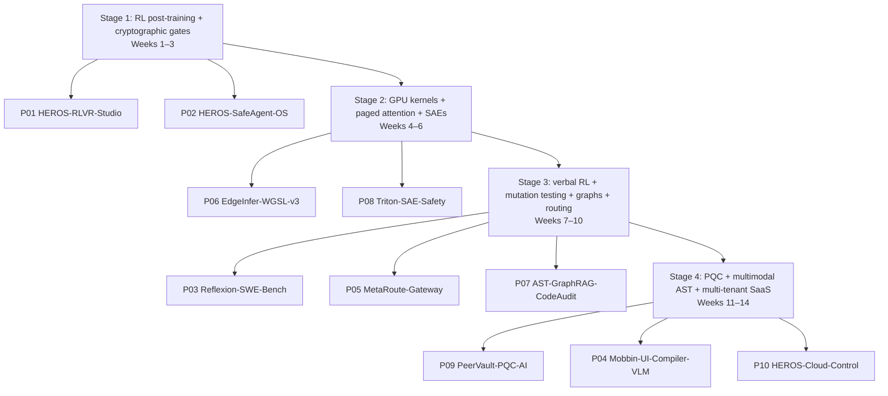

# Skills Roadmap — Dependency Graph

Learning is sequenced by **unblocking projects**, not by consuming courses. Each
stage has a mathematical prerequisite, a systems prerequisite, a reading list, a
build assignment, and an exit test. Do not start a stage until the previous exit
test passes.

---

## Stage 1 — Verifiable RL post-training and cryptographic tool gates

**Weeks 1–3. Unblocks P01 and P02.**

| Prerequisite | Specific content |
|---|---|
| Math | Policy gradient theorem; importance sampling `r_t(θ)`; group advantage `A_i = r_i − mean(r)`; Dr.GRPO constant horizon `L_max`; k3 KL `exp(ρ)−ρ−1`; Bradley-Terry; Merkle inclusion proof `O(log N)`. |
| Systems | 4-bit NF4 QLoRA; gradient checkpointing; `paged_adamw_8bit` on 6 GB; Node 22 MCP stdio/HTTP; Zero static binaries; SQLite in-memory shadow DB; `flock`/WAL. |
| Reading | DeepSeekMath (2402.03300); Dr.GRPO (2503.20783); DAPO (2503.14476); GRPO U-statistic (2603.01162); HF TRL/PEFT docs; MCP 2025-11-25 spec. |
| Build | `gpu_trainer.py` + shadow verifier (done, #101); `qlora_runner.py`; 75+ tests; 500-step run. |
| Exit test | Explain why GRPO removes the critic without collapsing; derive the Dr.GRPO denominator; pass 75 tests; produce a run log with peak VRAM and a loss curve. |

**Anti-pattern to avoid:** tuning a reward model before verifying the deterministic
reward. If the SQLite gate disagrees with the manifest, the gate wins.

---

## Stage 2 — GPU compute shaders, PagedAttention, and SAEs

**Weeks 4–6. Unblocks P06 and P08.**

| Prerequisite | Specific content |
|---|---|
| Math | Roofline `min(compute, bandwidth)`; SRAM tiling; online softmax `m_new = max(m_old, m_block)`; Matryoshka nested loss; Top-K SAE `z = TopK(W_e(x−b_d)+b_e)`. |
| Systems | WGSL workgroups/shared memory; `GPUBuffer` binding and `mapAsync` costs; ONNX Runtime Web ≥1.21; Triton JIT; coalesced HBM; activation hooks on Turing SM 7.5. |
| Reading | FlashAttention-2 (2307.08691); PagedAttention (2309.06180); MRL (2205.13147); Top-K SAE (2406.04093); Scaling Monosemanticity. |
| Build | P06 CPU reference + WGSL parity harness; P08 eager SAE + fused Triton kernel. |
| Exit test | Prove zero `mapAsync` on KV buffers; match ORT logits within tolerance; show a roofline chart with achieved bandwidth; reproduce `R²>0.92` on a held-out activation set. |

**Anti-pattern:** publishing a shader that compiles but does not attend. Parity
first, speed second.

---

## Stage 3 — Verbal RL, mutation testing, graphs, and bandit routing

**Weeks 7–10. Unblocks P03, P05, P07.**

| Prerequisite | Specific content |
|---|---|
| Math | Reflexion's `θ={M_a, mem}`; mutation adequacy `killed/total`; Bradley-Terry; latent context `z=E_φ(c_1:N)`; Leiden modularity `Q`; HNSW recall. |
| Systems | Docker sandboxing; Tree-sitter AST + taint; Hypothesis; igraph/leidenalg; INT8 ONNX export; DuckDB. |
| Reading | Reflexion (2303.11366); SWE-bench (2310.06770); RouteLLM (2406.18665); MetaRouter (2606.06178); GraphRAG (2404.16130). |
| Build | Mutation-gated Reflexion harness; K≥4 ONNX router; AST-GraphRAG with incremental Leiden. |
| Exit test | Eliminate the MBPP regression on a held-out subset; report APGR/CPT-95/p99; Recall@10 >0.88 on 100 multi-hop queries. |

**Anti-pattern:** using an LLM to extract graph edges from code. The compiler
already knows the AST; use it.

---

## Stage 4 — PQC, multimodal ASTs, and multi-tenant SaaS

**Weeks 11–14. Unblocks P09, P04, P10.**

| Prerequisite | Specific content |
|---|---|
| Math | MLWE over `R_q = Z_3329[X]/(X^256+1)`; 7-layer NTT; Montgomery reduction; HKDF; AES-GCM AAD; bounding-box IoU; WCAG contrast. |
| Systems | Rust `no_std` wasm32; WebRTC SCTP; OPFS streaming; Playwright; axe-core; Mobbin MCP; `npx ui-skills`; Next.js static export. |
| Reading | FIPS 203; Design2Code (2403.03163); WebGPU WGSL spec; OPFS/File System Access docs. |
| Build | OPFS `ChunkBitmap` resume + EdgeInfer shard streaming; VLM UI-AST compiler; HEROS Cloud GitHub App. |
| Exit test | 100/100 KAT; <64 MB RSS on 500 MB; real cross-reload resume; 100% WCAG AA on the generated set; 100% tamper detection on the receipt UI. |

**Anti-pattern:** rolling your own crypto for production. This is a learning and
verification artifact; state that it is not independently audited.

---

## Weekly operating rhythm

| Day | Activity |
|---|---|
| Mon | Pick one project gate; write the acceptance test first. |
| Tue–Thu | Implement; run the full suite daily; commit on a feature branch. |
| Fri | Benchmark on real hardware; write the result and the limitation. |
| Sat | One upstream issue/PR read; one paper section; update the log. |
| Sun | Rest or a 30-minute review of the week's diff. |

**Time budget:** 12–15 focused hours/week. The 14-week plan assumes this. If only
6 hours/week are available, double the timeline; do not compress the exit tests.

---

## Skill evidence ledger

| Skill | Evidence (target) | Status |
|---|---|---|
| PyTorch autograd | Custom backward + gradient check in P01 | Partial (loss + fake-policy runner) |
| QLoRA / NF4 | 500-step run log + adapter | Runner implemented; no GPU run |
| GRPO / Dr.GRPO / DAPO | 75 tests + ablation | 85 tests; no ablation |
| Triton | Fused Top-K SAE + roofline | Not started |
| WGSL | Paged decode parity + zero readback | Design note |
| MCP / agent security | 500-case bench + Ed25519 proofs | 289 cases |
| Tree-sitter / Leiden | 1,000-query codebench | Not started |
| Rust WASM / PQC | 100/100 KAT + resume | KAT documented |
| Multimodal UI | 100% WCAG AA + IoU | Not started |
| Multi-tenant SaaS | GitHub App + tamper UI | Simulation |

The ledger is the resume. A skill without an evidence row is a claim, not a skill.
